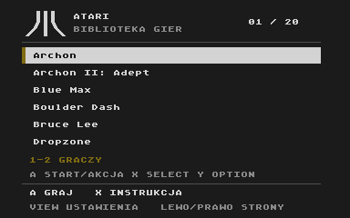

# Atari XL na ESP32

Mała konsola retro do samodzielnego zbudowania. Podłączasz ją do telewizora,
wybierasz grę z karty microSD i grasz padem Xbox. Komputer jest potrzebny do
przygotowania oprogramowania, ale nie do samej gry.

**[Zbuduj własną konsolę →](docs/getting-started.md)**

## Co już działa

- Biblioteka gier z menu i instrukcjami na ekranie telewizora.
- Dwa pady Xbox: dodawanie, usuwanie przypisań i zamiana graczy z menu.
- Gry na microSD, wczytywane dopiero po wybraniu tytułu.
- Obraz przez RCA i dźwięk mono w obu kanałach telewizora.
- Aktualizacja oprogramowania przez Wi-Fi.
- Altirra BASIC uruchamiany, gdy karta microSD nie odpowiada.

Katalog zawiera opisy i ustawienia **20 gier**. Ich pliki dostarczasz
samodzielnie — repozytorium nie zawiera gier ani oryginalnych ROM-ów Atari.
Oprogramowanie można zbudować również bez nich, korzystając z otwartych
zamienników systemu i BASIC-a.

## Sprawdzony zestaw

| Element | Wersja użyta w projekcie |
| --- | --- |
| Płytka | Waveshare ESP32-DEV-KIT-WROVER-E-M, SKU 35528; 16 MB flash i 8 MB PSRAM |
| Kontrolery | Xbox Wireless Controller, model 1914 |
| Czytnik kart | Moduł SDTF-02 i karta microSD z systemem plików FAT32 |
| Telewizor | Wejście composite lub konwerter AV → HDMI; tryb obrazu „Gra” |

Instrukcja opisuje ten zestaw. Płytki ESP32-S3 i ESP32-C3 wymagają osobnego
dostosowania projektu.

## Dokumentacja

| Chcę… | Od czego zacząć |
| --- | --- |
| Kupić części, połączyć układ i wgrać program | [Budowa krok po kroku](docs/getting-started.md) |
| Poznać sterowanie, dodać gry lub zrobić aktualizację | [Obsługa konsoli](docs/user-guide.md) |
| Rozwijać kod i uruchamiać testy | [Dokumentacja techniczna](docs/development.md) |
| Sprawdzić pochodzenie kodu i licencje | [Wykorzystane projekty](THIRD_PARTY.md) |

## Co dalej

Planujemy zarządzanie biblioteką przez przeglądarkę i obsługę klawiatury
Bluetooth. Na razie katalog gier jest zapisany
w oprogramowaniu, a BASIC nie obsługuje jeszcze pisania z klawiatury BT ani
zapisywania własnych programów.

Własny kod projektu udostępniamy na licencji [MIT](LICENSE). Wykorzystane
biblioteki i rdzeń emulatora zachowują [swoje licencje](THIRD_PARTY.md).
