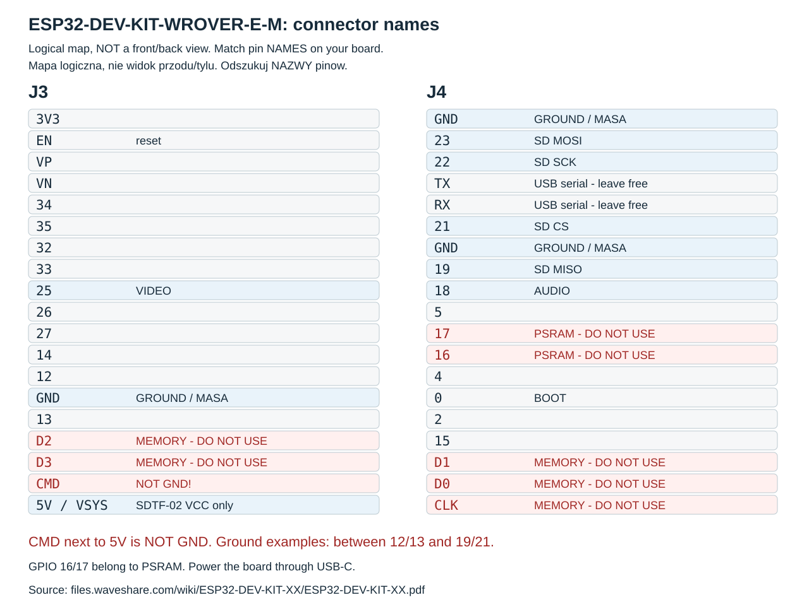
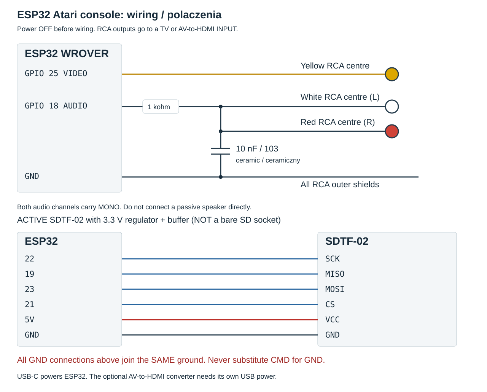

# Build your own ESP32 Atari console

[Project](../README.md) · [Polska instrukcja](getting-started.md) · [Game catalogue and controls (Polish)](user-guide.md)

This guide targets **Windows 10/11 and Waveshare ESP32-DEV-KIT-WROVER-E-M,
SKU 35528**, with soldered headers, classic ESP32 ECO3, 16 MB flash and 8 MB PSRAM.
ESP32-C3 and ESP32-S3 are not drop-in replacements.

**Verification status:** the prototype works and source-only builds have been
checked. A complete installation using this guide on a second, blank board has
not yet been confirmed on hardware. Do not run the first-install procedure on
an already working console. Use the normal update procedure in section 13.

Build in stages: video and BASIC first, then controllers and microSD, then audio.
Disconnect power before changing wiring or inserting/removing the card.

## 1. Parts and tools

| Item | Requirement |
| --- | --- |
| Board | Waveshare SKU 35528, as specified above |
| Controller | Xbox Wireless Controller model 1914 with Bluetooth; a second is optional |
| Display | NTSC-compatible composite/CVBS input, or HDMI with a converter |
| Optional converter | **AV/RCA/CVBS input to HDMI output**, separately USB-powered; HDMI-to-AV is the wrong direction |
| RCA connections | One video connector; one or two audio connectors; RCA cable; HDMI cable only if using a converter |
| Audio filter | One 1 kΩ resistor, e.g. 0.25 W, and one 10 nF ceramic capacitor marked **103**; 104 means 100 nF |
| Storage | Active SDTF-02 SPI module with a 3.3 V regulator and buffer, plus a FAT32 microSD card; 4 or 8 GB is sufficient |
| Wiring | Female-to-female Dupont jumpers for headers; jumpers suitable for the breadboard and RCA terminals |
| Breadboard | For the shared ground and audio filter; a larger board is easier to assemble |
| Meter | Multimeter with continuity and resistance modes |
| Power and USB | USB-C **data** cable for the ESP32; reliable 5 V USB power; separate USB supply for the optional converter |
| Computer | Windows, internet access for preparation, and a USB port |
| Card reader | Needed for the card-copy method below; it is not part of the console |

Essential prototype components cost 67 PLN, plus wires, a resistor and a capacitor:
roughly **EUR 18** for the basic console. This is a project estimate, not a current
shop quotation. Controllers, display, tools and an existing USB supply are extra.
The HDMI converter and HDMI cable are optional extras.

Flash storage is not working RAM. The emulator needs the WROVER's extra PSRAM.
Games and original Atari ROMs are not included in the repository.

## 2. Identify the connections



This is a logical map of the named connectors, not a front/back photograph or
a template for counting pins. Match the **printed names** on your own board.
Turning the board over mirrors its physical layout.

GPIO 25 means the pin marked `25` or `IO25`. `G`/`GND` means ground. `3V3` and
`5V` are power, not ground. The pin between **5V and D3 is CMD, not GND**.
Real ground pins include those between 12/13 and 19/21. Do not use CMD, CLK or
D0–D3: they belong to the module's memory interface. GPIO 16/17 are used by
PSRAM; leave RX/TX available for USB serial.



| ESP32 | Destination |
| --- | --- |
| GPIO 25 | Yellow video RCA centre |
| GPIO 18 | 1 kΩ series resistor, then shared audio L/R signal and 10 nF capacitor to ground |
| GPIO 22 | SD SCK |
| GPIO 19 | SD MISO |
| GPIO 23 | SD MOSI |
| GPIO 21 | SD CS |
| 5V | VCC of the active SDTF-02 described in section 10 |
| GND | SD ground, audio-filter ground and the outer shields of all RCA connectors |

All ground points are common. Use another real GND pin or a breadboard node if
one is occupied. Power the ESP32 through USB-C; do not feed an additional supply
into its 5V/3V3 headers at the same time.

Before using a breadboard, check which holes connect internally with a continuity
meter, with power disconnected. A beep or near-zero resistance indicates a
connection. Small 5×5 boards may connect columns; larger breadboards normally
connect groups of five. A connected group is called a **node** below.

References: [Waveshare schematic](https://files.waveshare.com/wiki/ESP32-DEV-KIT-XX/ESP32-DEV-KIT-XX.pdf)
and [board documentation](https://docs.waveshare.com/ESP32-DEV-KIT-XX).

## 3. Connect video first

Leave SD and audio disconnected for now. Connect **GPIO 25 to the centre (+)**
of the video RCA terminal and **GND to its shield (−)**.

**Composite TV:** connect directly to the TV's yellow VIDEO/CVBS/AV input and
select AV. The input must support NTSC. Component YPbPr is not automatically
composite; check the TV manual. A minijack AV socket requires the correct
manufacturer-specific adapter.

**HDMI display:** connect the RCA cable to the converter's CVBS/VIDEO IN,
connect its HDMI output to the display, and power the converter through its own
USB socket. HDMI alone does not power it. Select that HDMI input.

For either option, enable the TV's **Game** picture mode to reduce latency.
Naming an input “Computer” did not achieve the same result on our Philips TV.
Connect the ESP32 to the computer through USB. Video starts only after section 8;
no picture before flashing is normal.

Firmware outputs **NTSC**. The converter's 720/1080 switch changes HDMI output
resolution, not the ESP32's video standard. Converter compatibility can vary.

## 4. Install the software on Windows

Install [Python 3.13](https://www.python.org/downloads/windows/) with the `py`
launcher, [Arduino IDE 2](https://www.arduino.cc/en/software/) and optionally
[Git](https://git-scm.com/download/win). Arduino IDE includes Arduino CLI.
Open PowerShell and download the project:

```powershell
New-Item -ItemType Directory -Force "$env:USERPROFILE\Projects" | Out-Null
cd "$env:USERPROFILE\Projects"
git clone https://github.com/zbylon80/esp32-atari-console.git
cd esp32-atari-console
```

Without Git, use **Code → Download ZIP** on GitHub, extract it, and open PowerShell
in the folder containing README.md. Run all following commands from that folder.

```powershell
py -3.13 -m venv .venv
.\.venv\Scripts\python.exe -m pip install -r requirements.txt
$cli = "$env:ProgramFiles\Arduino IDE\resources\app\lib\backend\resources\arduino-cli.exe"
Test-Path $cli
```

If `False`, try the per-user installation:

```powershell
$cli = "$env:LOCALAPPDATA\Programs\Arduino IDE\resources\app\lib\backend\resources\arduino-cli.exe"
Test-Path $cli
```

If still `False`, locate `arduino-cli.exe` inside your IDE installation and set
`$cli` to its full path. Continue only when the file exists:

```powershell
$env:ARDUINO_CLI = $cli
& $cli version
$urls = "https://espressif.github.io/arduino-esp32/package_esp32_index.json,https://raw.githubusercontent.com/ricardoquesada/esp32-arduino-lib-builder/master/bluepad32_files/package_esp32_bluepad32_index.json"
& $cli core update-index --additional-urls $urls
& $cli core install esp32:esp32@2.0.17 --additional-urls $urls
& $cli core install esp32-bluepad32:esp32@4.1.0 --additional-urls $urls
& $cli core list
```

Expected: `esp32-bluepad32:esp32` version **4.1.0**. It is a board package, not
an ordinary Bluetooth library. Keep these pinned versions. The scripts use the
standard `%LOCALAPPDATA%\Arduino15` package directory. If deliberately using
another package directory, set `ARDUINO_DATA_DIR` to it as well. Reapply
`ARDUINO_CLI` in a new PowerShell window if your CLI path is not the default.

## 5. Configure private Wi-Fi settings

```powershell
.\.venv\Scripts\python.exe tools/configure.py
```

Enter your 2.4 GHz SSID and password; the password is hidden while typing.
The tool creates `local/config.json` with a random update token. Keep a private
backup: future updates must use that same token. Do not publish this file,
flash backups or compiled updater firmware, which includes network credentials.
Wi-Fi runs only in update mode; ordinary gameplay does not need internet access.

## 6. Build without games or an original Atari ROM

```powershell
.\.venv\Scripts\python.exe tools/build.py
```

The script downloads pinned emulator sources and open Altirra replacements,
then compiles the console and updater sequentially. It does not download games
or the original Atari OS and does not flash anything. Allow several minutes.
Expected: `PASS archon` and `PASS updater`; output files are under `.build/`.

## 7. Identify the USB port and board

Connect using a USB data cable. In Device Manager, expand **Ports (COM & LPT)**.
The tested board uses CH343P. COM1 labelled “Communications Port” is usually
unrelated. Replace COM7 below with your actual port:

```powershell
.\.venv\Scripts\python.exe -m serial.tools.list_ports -v
.\.venv\Scripts\python.exe tools/board-info.py --port COM7
```

Expected: classic ESP32 revision 3 or later, a unique MAC address and 16 MB flash.
Save that board's MAC. If an unknown USB device appears, install the
[WCH CH343 driver](https://www.wch-ic.com/downloads/CH343SER_EXE.html), reconnect
and check the port again. If nothing appears at all, try a known data cable and
a direct USB port instead of a hub.

If the tool stops at **Connecting**, close serial monitors. Following
[Waveshare's download-mode procedure](https://docs.waveshare.com/ESP32-DEV-KIT-XX/FAQ),
hold **BOOT**, press and release **EN/RESET**, then release BOOT. Retry board-info.
EN/RESET starts the program normally after the operation. Do not erase flash
or short unidentified pins to fix a serial-port problem.

## 8. First installation — new boards only

This writes the bootloader, partition table, console and separate updater,
replacing the board's previous program. It first saves a flash backup under
`.build/backups/`. Close all serial monitors. Use your own port and MAC:

```powershell
.\.venv\Scripts\python.exe tools/install-new-board.py --port COM7 --confirm-mac AA:BB:CC:DD:EE:FF --initialize-new-board
```

The tool checks identity, revision, flash size and artifacts. It refuses a board
already using our partition layout. Never use it for normal updates. Do not use
IDE Upload, `erase_flash`, or flash `boot_app0.bin` at 0xE000: our NVS occupies
that address range. Keep power connected until the operation finishes.

Expected without a card: boot screen, a short SD-not-responding message, then
**Altirra BASIC / Ready**. This checks the emulator and video output. Bluetooth
keyboard input and BASIC program saving are not implemented yet. Solve video
problems before attaching more hardware. The complete fresh-board procedure
still needs the independent hardware check stated at the start of this guide.

## 9. Pair controllers

1. Turn on the first Xbox controller. Leave the second off.
2. Hold its small pairing button near USB until the Xbox logo flashes rapidly.
3. Wait for connection, then press and release A. It becomes player 1.
4. View (overlapping squares) opens BASIC's menu. Check D-pad navigation.
5. For a second controller, use **View → USTAWIENIA → KONTROLERY → GRACZ 2 → DODAJ PAD**.
   Turn on the second controller, enter pairing mode, then press and release A.

The console remembers player assignments, independent of connection order.
In English the path is **SETTINGS → CONTROLLERS → PLAYER 2 → ADD CONTROLLER**;
section 13 explains switching language. If a controller reconnects to a PC or
Xbox instead, temporarily disable Bluetooth there. Do not clear the ESP32's
pairing keys during ordinary updates.

For later changes, open Controllers. Add a controller to an empty slot, swap
players, or remove a player's assignment. Manual adding has a 60-second window;
B/View cancels it. Player 1 enrolment on a completely unassigned console is
automatic without a time limit. Removing an assignment does not wipe all
Bluetooth library keys. Release all controls after swapping players.

## 10. Connect microSD

Disconnect power. This wiring is for the **active SDTF-02 module with its own
3.3 V regulator and buffer**, as used in the prototype. Never supply 5 V to
a bare microSD socket. Check a different module's schematic before connecting it.

| SDTF-02 | ESP32 |
| --- | --- |
| SCK | GPIO 22 |
| MISO | GPIO 19 |
| MOSI | GPIO 23 |
| CS | GPIO 21 |
| VCC | 5V |
| GND | Real GND, e.g. between 19/21, **not CMD next to 5V** |

Use short wires. They can run directly between the module and board; running
out of breadboard holes does not mean running out of GPIO pins.

Use **FAT32**, not exFAT. A blank 4 or 8 GB card is easiest: confirm its drive
letter in Windows, then select FAT32 in its Format dialog. Back up existing
files before formatting. Larger cards may work with FAT32, but capacity alone
does not prove compatibility. Do not format a card containing important files
as an experiment.

## 11. Add your own game files

There are **33 game profiles**, not 33 included game files. Exact filenames,
sizes and SHA-256 values are in `tools/wrover/library.json`. Use lawfully
obtained matching versions; renaming an arbitrary image is insufficient.

1. Put your matching files in a computer folder, e.g. `C:\AtariGames`.
2. Insert the card into a computer reader. Confirm its drive letter; E: is
   only an example below.
3. Verify first, then copy:

```powershell
.\.venv\Scripts\python.exe tools/copy-games.py --source C:\AtariGames --card E:\ --verify-only
.\.venv\Scripts\python.exe tools/copy-games.py --source C:\AtariGames --card E:\
```

The script copies only matching files into `atari-console/games/`. It does not
format the card, overwrite a conflicting file, or change other directories.
Missing sources are skipped; mismatched versions are reported and skipped.
Safely eject in Windows, insert with the console off, then start it.

The menu scan checks names and sizes. Pressing A loads and verifies the selected
game into PSRAM. Other games are not loaded at startup. Missing or unsupported
entries are dimmed. Seksmisja needs both disk sides; View offers **INSERT SIDE A/B**.

Six profiles need your own **Atari XL rev. 2 OS ROM**: Alley Cat, Misja,
New York City - The Big Apple, Road Race, Spy vs. Spy and Spy vs. Spy II.
If you have the matching ROM, place it at `local/roms/atarixl.rom` (16384 bytes),
check the `bios` metadata in the catalogue, rebuild and update. For example:

```powershell
Get-FileHash -Algorithm SHA256 .\local\roms\atarixl.rom
```

Without that ROM these six profiles stay unavailable, even with matching game
files. Other profiles use AltirraOS. The original ROM remains private and is
not needed to build or start BASIC. Copying a new, uncatalogued game to the card
does not automatically add it to the menu. The [full catalogue](user-guide.md#tytuły-w-katalogu)
lists all titles and their OS requirements. Agent USA's travel requires Atari
keyboard input; the gamepad alone cannot provide that functionality.

## 12. Connect audio: mono through both channels

Disconnect power. Neither the resistor nor ceramic capacitor has polarity.
Build this filter, then connect it to the TV/converter's **line-level inputs**:

```text
GPIO 18 ---[ 1 kohm ]---+---- white RCA centre: AUDIO L IN
                       +---- red RCA centre: AUDIO R IN
                       |
                      10 nF (103)
                       |
GND -------------------+---- outer shields of both RCA connectors
```

Use three separate breadboard nodes:

| Node | Connections |
| --- | --- |
| Filtered signal | One resistor leg, one capacitor leg, both audio RCA centres |
| ESP32 output | GPIO 18 and the other resistor leg |
| Ground | GND, the other capacitor leg, both audio RCA shields |

The resistor bridges output and filtered signal. The capacitor bridges signal
and ground. Do not short the nodes together. On a 6 kΩ meter range, 0.966 means
about 966 Ω; measure the resistor unpowered and preferably disconnected.
Use secure connections if thin component leads do not grip the breadboard.
Both channels carry the same mono signal; one GPIO is sufficient. Do not drive
a passive speaker directly from this connection.

## 13. Language, controls and normal updates

**Language:** in the library, View opens Settings directly. Choose **JEZYK: POLSKI**
and press A for English. **LANGUAGE: ENGLISH** toggles back to Polish. In a game
or BASIC, use View and select Settings first. The setting survives power-off and
affects console menus/help, not the language of the original games.

| Button | Action |
| --- | --- |
| D-pad or left stick | Move / menu navigation |
| A or RT | Fire / main action; A confirms menu choices |
| View | Console menu; Settings directly from the library |
| RB / LB / LT | Atari OPTION / SELECT / START |
| X in library/pause | Game help; X or left/right switches its two pages |
| B in menus | Back |

Other ABXY actions depend on each game's help. Choose one/two players and sides
on the original game screens; the console does not replace those menus.
Change the card only with power off. Inserting it while BASIC runs does not
automatically open the library: restart with the card inserted.

For an already installed console, build on the computer first:

```powershell
.\.venv\Scripts\python.exe tools/build.py
```

From the library use **View → WI-FI UPDATE → A**. During a game or BASIC, enter
Settings first. Read the IP address from the display, then use that real address:

```powershell
.\.venv\Scripts\python.exe tools/update.py --host 192.168.1.50
```

The computer and console must be on the same network. Keep power connected.
The update checks the token and image hash, preserves partitions and player
assignments, then restarts. Re-enter update mode if its time window expires.
This updates the console app, not the separate updater program. Running
`configure.py` again does not change credentials or the token already embedded
in that updater. Keep the original private `local/config.json` backup.
Automatic internet update checking is not implemented.

## 14. Checks and troubleshooting

After assembly, check: BASIC without a card; menu navigation and reconnection
of both assigned controllers; language persistence; loading a matching game
from FAT32; return from pause; mono sound on both channels; stable video with
Game mode enabled. If using Wi-Fi, check that a normal update preserves players.
These are checks for your build, not a claim of an independent fresh-board test.

| Symptom | Check |
| --- | --- |
| No COM port | Known data cable, direct USB port, CH343 driver, power |
| Port busy / Connecting | Close serial monitors; check COM; use BOOT + EN from section 7 |
| USB fails after adding SD | Power off; check GND versus CMD and accidental RX/TX connections |
| Converter says No signal | Its USB power, AV-to-HDMI direction, correct input, GPIO25 centre/GND shield, cable continuity, NTSC support |
| Controller latency | TV Game picture mode, then controller battery/connection |
| BASIC with card inserted | SD wiring, suitable module supply, true ground, contacts; card did not respond |
| Library error | FAT32, filenames and paths; do not format valuable data without backup |
| Dim game | Missing/wrong-size file, or required original ROM absent from local build |
| Content/hash error | Exact catalogue version and reliable SD reading |
| Only one audio channel | Both centres must join after the resistor; both shields join GND |
| Update unreachable | Active update mode, same network, actual IP, original config/token |
| HTTP 401 / token rejected | Use this console's original config; a new random token does not match |

Read serial logs if needed:

```powershell
.\.venv\Scripts\python.exe -m serial.tools.miniterm COM7 115200
```

Exit with Ctrl+], and close the terminal before flashing. Include error text,
board model and software versions in an issue. Do not attach credentials,
flash backups, games or original ROMs. For development see [development.md](development.md).
