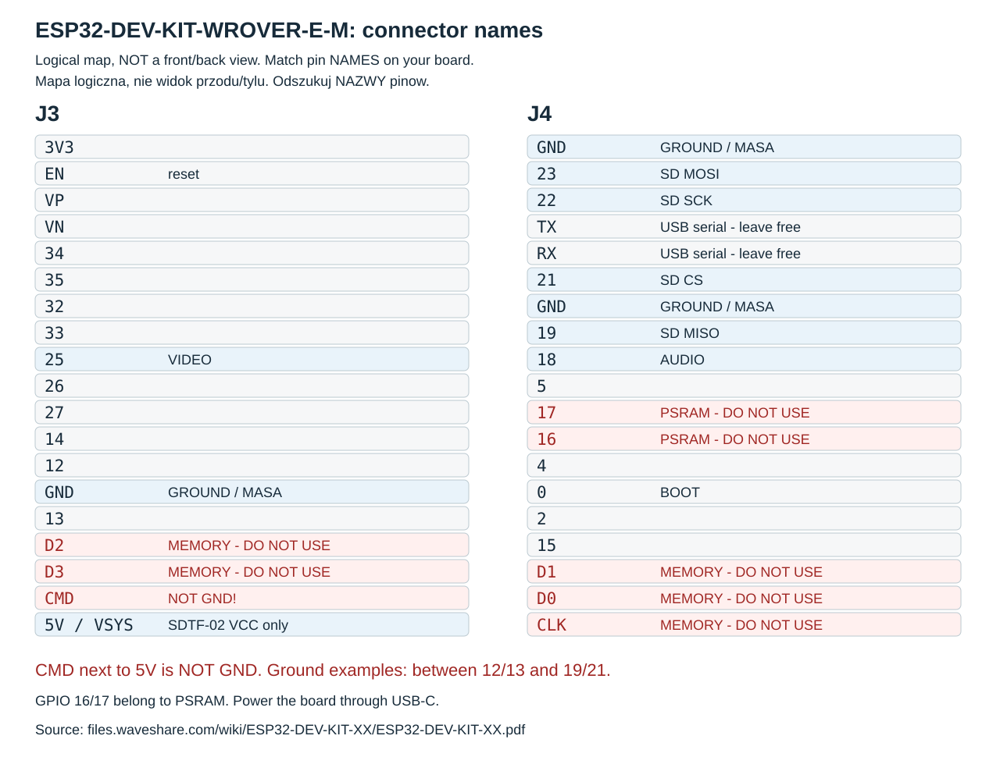
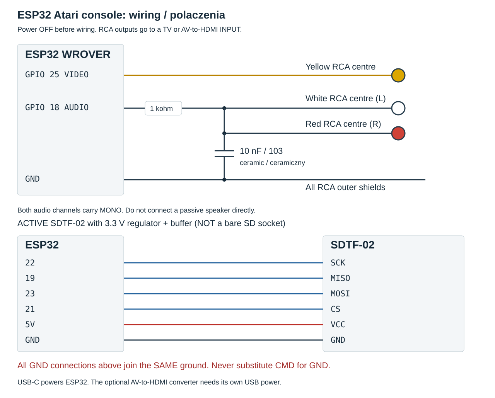

# Zbuduj własną konsolkę — instrukcja od zera

[← Strona projektu](../README.md) · [Obsługa konsoli](user-guide.md) · [English DIY guide](getting-started.en.md)

Instrukcja prowadzi przez budowę zestawu z płytką Waveshare
ESP32-DEV-KIT-WROVER-E-M (SKU 35528) i przygotowanie oprogramowania na Windows.
Po każdym etapie znajdziesz opis oczekiwanego wyniku.

**Stan weryfikacji:** prototyp działa, a kompilacja bez gier i oryginalnego ROM-u
była sprawdzana. Pełne przejście tej instrukcji na drugiej, pustej płytce nie jest
jeszcze potwierdzone sprzętowo. Pierwsza instalacja z etapu 8 dotyczy wyłącznie
nowej płytki; działającą konsolę aktualizuj według etapu 13.

1. **Uruchom obraz i BASIC** — [części i połączenia](#1-co-przygotować),
   [programy na komputerze](#4-zainstaluj-programy-na-komputerze),
   [pierwsze wgranie](#8-pierwsze-wgranie--tylko-na-nową-płytkę).
2. **Przygotuj konsolę do gry** — [parowanie pada](#9-sparuj-pierwszy-potem-drugi-pad),
   [czytnik microSD](#10-dołącz-microsd), [pliki gier](#11-dodaj-własne-gry).
3. **Dokończ zestaw** — [dźwięk](#12-dołącz-dźwięk-mono-w-obu-kanałach),
   [aktualizacje](#13-codzienne-sterowanie-i-aktualizacja).

Jeśli utkniesz, zajrzyj do [diagnostyki](#14-gdy-coś-nie-działa).

## 1. Co przygotować

| Część | Ile i jaka |
| --- | --- |
| Płytka | 1 × Waveshare SKU 35528, z wlutowanymi pinami; klasyczny ESP32 ECO3, 16 MB flash i 8 MB PSRAM. |
| Pad | 1 × Xbox Wireless Controller 1914 z Bluetooth; drugi identyczny jest opcjonalny. |
| Ekran | TV z wejściem composite/CVBS lub HDMI. |
| Konwerter | Przy TV HDMI: **AV/RCA/CVBS → HDMI**, z wejściem video i własnym zasilaniem USB. **HDMI → AV działa w odwrotną stronę i nie pasuje.** |
| RCA | Gniazdo/złączka śrubowa dla video; jedna lub dwie kolejne dla audio, przewód RCA; HDMI do TV. |
| Rezystor audio | 1 × 1 kΩ, np. o mocy 0,25 W. |
| Kondensator audio | 1 × 10 nF ceramiczny, oznaczenie **103**. Uwaga: oznaczenie 104 wskazuje inną wartość — 100 nF. |
| microSD | Moduł SDTF-02 ze stabilizatorem 3,3 V, karta FAT32; 4 lub 8 GB w zupełności wystarczy. |
| Przewody | Dupont żeńsko-żeńskie do dwóch rzędów pinów oraz przewody do płytki stykowej i złączek. |
| Płytka stykowa | 1 × do rozprowadzenia masy i filtra audio; większy model ułatwia montaż. |
| Miernik | Multimetr z pomiarem ciągłości i rezystancji do sprawdzenia połączeń. |
| Zasilanie | Kabel USB-C **z transmisją danych** do ESP32, zasilanie USB konwertera; docelowo stabilne 5 V. |
| Komputer | Windows 10/11 z dostępem do internetu i wolnym USB. |
| Czytnik karty | Potrzebny do opisanej najprostszej metody kopiowania własnych gier z komputera. Nie jest częścią konsolki. |

Wybierz podany model płytki. W ofertach „4 MB” często oznacza pamięć flash,
czyli miejsce na program, a nie RAM używany podczas jego pracy. Ten zestaw
korzysta także z PSRAM — dodatkowej pamięci potrzebnej emulatorowi.
Płytki ESP32-S3 i ESP32-C3 wymagają zmian w projekcie.

Orientacyjny koszt podstawowych części prototypu wyniósł 67 zł, do tego przewody,
rezystor i kondensator — w przybliżeniu 18 EUR. To koszt tego zestawu, nie aktualna
wycena sklepowa. Pady, ekran, miernik, narzędzia i istniejący zasilacz są poza tą
kwotą. Konwerter AV→HDMI oraz kabel HDMI dokupujesz tylko do ekranu bez zgodnego
wejścia composite RCA. Audio podłączasz do wejścia liniowego TV/konwertera,
nie bezpośrednio do głośnika.

## 2. Jak czytać piny i płytkę stykową

**Odłącz zasilanie przed wkładaniem/wyjmowaniem przewodów i karty.**
GPIO 25 to pin opisany `25` lub `IO25`; nie „dwudziesty piąty pin od góry”.
G/GND oznacza wspólną masę, czyli punkt odniesienia wszystkich sygnałów.
3V3 i 5V to zasilanie — nie masa.

Na tej płytce pin **między 5V a D3 to CMD, a nie GND**. Napis bywa trudny do
odczytania. Prawdziwe masy są m.in. **między 12 i 13** oraz **między 19 i 21**.
Nie podłączaj nic do CMD, CLK, D0–D3; są związane z pamięcią modułu.
GPIO 16 i 17 są zajęte przez PSRAM; RX/TX pozostaw dla USB.
Porównaj z [oficjalnym schematem Waveshare](https://files.waveshare.com/wiki/ESP32-DEV-KIT-XX/ESP32-DEV-KIT-XX.pdf).



To mapa logiczna obu złączy, nie zdjęcie ani szablon do liczenia pinów od góry.
Odszukuj **nazwy** na swojej płytce; po odwróceniu płytki strony zamieniają się
miejscami. Wyróżnione sygnały są używane przez konsolkę. CMD nie jest masą.

### Wszystkie połączenia w jednym miejscu



| Wyprowadzenie ESP32 | Dokąd prowadzi |
| --- | --- |
| GPIO 25 | Środek żółtego RCA video |
| GPIO 18 | Rezystor 1 kΩ, a za nim wspólny sygnał audio L/R i kondensator 10 nF do GND |
| GPIO 22 / 19 / 23 / 21 | SCK / MISO / MOSI / CS aktywnego SDTF-02 |
| 5V | Wyłącznie VCC aktywnego SDTF-02 opisanego w etapie 10 |
| GND | Ekrany wszystkich RCA, masa filtra audio i GND modułu SD |

Jeśli jedno GND jest zajęte, użyj innego prawdziwego GND lub wspólnego węzła na
płytce stykowej. Wszystkie te masy mają być połączone. Zasilaj ESP32 przez USB-C;
nie podłączaj jednocześnie drugiego źródła zasilania do jego pinów 5V/3V3.

W płytce stykowej kilka otworów jest wewnętrznie połączonych. Kierunek
połączeń zależy od modelu: mały blok 5 × 5 może łączyć kolumny, a duża płytka
zwykle łączy grupy pięciu otworów po obu stronach środkowej szczeliny.
Sprawdź to miernikiem ustawionym na badanie ciągłości, przy odłączonym
zasilaniu. Sygnał dźwiękowy lub wynik bliski 0 Ω oznacza połączenie.
W dalszej instrukcji każdą taką grupę połączonych styków nazywamy węzłem.

## 3. Najpierw sam obraz

Jeszcze nie podłączaj modułu SD ani audio. Przygotuj jedną złączkę RCA.

| ESP32 | Połączenie |
| --- | --- |
| GPIO 25 | „+” złączki RCA, czyli środkowy styk video. |
| G/GND | „−” złączki, czyli zewnętrzny ekran RCA. |

**Wariant A — TV ma wejście composite RCA:** połącz żółty przewód bezpośrednio
z **VIDEO IN / CVBS / AV IN** telewizora i wybierz wejście AV. Konwerter i kabel
HDMI nie są potrzebne. TV musi przyjmować NTSC przez to wejście. Złącze component
YPbPr nie jest automatycznie wejściem composite; sprawdź opis TV. Gniazdo AV
w postaci minijacka wymaga przejściówki właściwej dla danego telewizora.

**Wariant B — ekran ma tylko HDMI:**

1. Kabel RCA połącz z żółtym **CVBS/VIDEO IN** konwertera AV→HDMI.
2. Wyjście HDMI konwertera połącz z ekranem i wybierz to wejście HDMI.
3. Podłącz własne zasilanie USB konwertera. Sam HDMI go nie zasila.

**W obu wariantach:**

1. Ustaw TV w trybie obrazu **Gra**. Nazwa wejścia „Komputer” nie gwarantuje
   tego samego. W testowanym telewizorze Philips dopiero tryb Gra usunął
   odczuwalne opóźnienie sterowania.
2. ESP32 na razie podłącz kablem USB do komputera. Obraz pojawi się dopiero
   po wgraniu firmware w etapie 8; pusty ekran teraz jest normalny.

Program wysyła obraz w standardzie **NTSC**. Przełącznik 720/1080
w konwerterze wybiera rozdzielczość HDMI, nie standard sygnału z ESP32.
Zgodność konwerterów z sygnałem generowanym przez ESP32 może się różnić.

## 4. Zainstaluj programy na komputerze

Potrzebujesz [Python 3](https://www.python.org/downloads/windows/),
[Arduino IDE 2](https://www.arduino.cc/en/software/) i opcjonalnie
[Git](https://git-scm.com/download/win). Wybierz Pythona 3.13 — tę wersję
sprawdzono. Przy instalacji włącz dostęp do polecenia `py`.
Arduino IDE dostarcza narzędzie Arduino CLI, którego używają poniższe polecenia.

Otwórz PowerShell. Utwórz folder `Projects` w swoim katalogu użytkownika,
jeśli jeszcze go nie masz. Następnie pobierz kod:

```powershell
New-Item -ItemType Directory -Force "$env:USERPROFILE\Projects" | Out-Null
cd "$env:USERPROFILE\Projects"
git clone https://github.com/zbylon80/esp32-atari-console.git
cd esp32-atari-console
```

Możesz też pobrać ZIP z GitHub przez Code → Download ZIP, rozpakować i otworzyć
PowerShell w katalogu zawierającym README.md. Dalsze polecenia wykonuj stąd.

Utwórz osobne środowisko Pythona; nie trzeba zmieniać zasad uruchamiania skryptów:

```powershell
py -3.13 -m venv .venv
.\.venv\Scripts\python.exe -m pip install -r requirements.txt
```

Sprawdź lokalizację CLI:

```powershell
$cli = "$env:ProgramFiles\Arduino IDE\resources\app\lib\backend\resources\arduino-cli.exe"
Test-Path $cli
```

Oczekiwany wynik: `True`. Jeśli jest `False`, sprawdź również
instalację tylko dla bieżącego użytkownika:

```powershell
$cli = "$env:LOCALAPPDATA\Programs\Arduino IDE\resources\app\lib\backend\resources\arduino-cli.exe"
Test-Path $cli
```

Jeśli nadal jest `False`, odszukaj `arduino-cli.exe` w katalogu instalacyjnym IDE
i przypisz jego pełną ścieżkę do `$cli`. Nie kontynuuj z nieistniejącą ścieżką.
Gdy `Test-Path` zwraca `True`, wykonaj:

```powershell
$env:ARDUINO_CLI = $cli
& $cli version
```

To ustawienie dotyczy bieżącego okna PowerShell. W nowym oknie ustaw je ponownie,
jeśli CLI nie jest zainstalowane w domyślnej lokalizacji. Poniższe polecenia
korzystają z pakietów w standardowym `%LOCALAPPDATA%\Arduino15`.
Jeśli celowo zmieniasz ten katalog, ustaw też `$env:ARDUINO_DATA_DIR` zgodnie
z własną konfiguracją; początkującym zalecamy ustawienie domyślne.

Zainstaluj dokładnie sprawdzony pakiet płytki, a nie jego najnowszą wersję:

```powershell
$urls = "https://espressif.github.io/arduino-esp32/package_esp32_index.json,https://raw.githubusercontent.com/ricardoquesada/esp32-arduino-lib-builder/master/bluepad32_files/package_esp32_bluepad32_index.json"
& $cli core update-index --additional-urls $urls
& $cli core install esp32:esp32@2.0.17 --additional-urls $urls
& $cli core install esp32-bluepad32:esp32@4.1.0 --additional-urls $urls
& $cli core list
```

Lista powinna zawierać `esp32-bluepad32:esp32` w wersji 4.1.0.
[Dokumentacja Bluepad32](https://bluepad32.readthedocs.io/en/latest/plat_arduino/)
wyjaśnia instalację pakietu. To pakiet obsługi płytki, a nie zwykła biblioteka
Bluetooth dodawana do programu.

## 5. Zapisz lokalną konfigurację Wi-Fi

```powershell
.\.venv\Scripts\python.exe tools/configure.py
```

Wpisz nazwę sieci 2,4 GHz i jej hasło. Hasło nie będzie wyświetlane podczas
wpisywania. Program zapisze `local/config.json` i utworzy losowy token — klucz
pozwalający później zatwierdzać aktualizacje.
Ten plik jest ignorowany przez Git. Zachowaj go: późniejszy aktualizator musi
korzystać z tego samego tokenu. Router nie musi dawać konsoli dostępu do internetu
podczas gry; Wi-Fi działa w osobnym trybie aktualizacji.

Nie udostępniaj `local/`, kopii flash ani zbudowanego aktualizatora — plik programu
zawiera dane Twojej sieci. Publiczne zgłoszenie błędu nie wymaga tych plików.

## 6. Skompiluj bez gier i bez oryginalnego ROM-u

```powershell
.\.venv\Scripts\python.exe tools/build.py
```

Pierwsze uruchomienie pobiera pliki źródłowe wybranej wersji emulatora
i otwarte zamienniki Altirra. Nie pobiera gier ani
oryginalnego systemu Atari. Następnie kompiluje osobno konsolę i aktualizator.
To może potrwać kilka minut.

Oczekiwane: dwie linie `PASS`, dla `archon` oraz `updater`, i komunikat
o zakończeniu bez wgrywania. Pliki znajdują się pod `.build/`.
Nie trzeba mieć żadnej gry, żeby ten etap zakończył się poprawnie.

## 7. Rozpoznaj port USB i konkretną płytkę

Podłącz ESP32 sprawdzonym kablem danych. W Menedżerze urządzeń rozwiń
„Porty (COM i LPT)”. Waveshare używa mostka CH343; numer może być inny na
każdym komputerze. `Communications Port (COM1)` zwykle nie jest ESP32.

```powershell
.\.venv\Scripts\python.exe -m serial.tools.list_ports -v
.\.venv\Scripts\python.exe tools/board-info.py --port COM7
```

Zastąp COM7 swoim portem. Odczyt powinien pokazać ESP32 rev3 lub nowszy,
unikalny adres **MAC** i 16 MB pamięci flash. Zapisz MAC z tej konkretnej płytki.
Jeśli nie pojawia się nowy port, wymień kabel, spróbuj bez huba USB i sprawdź
sterownik CH343 producenta płytki. Kabel wyłącznie do ładowania nie wystarczy.

### Gdy Windows nie pokazuje płytki

1. Otwórz Menedżer urządzeń i obserwuj zmianę po odłączeniu/podłączeniu USB.
2. Jeśli pojawia się nieznane urządzenie, sprawdź sterownik CH343/CH343P na
   [stronie producenta układu WCH](https://www.wch-ic.com/downloads/CH343SER_EXE.html).
   Po instalacji ponownie podłącz płytkę i odczytaj nowy numer COM.
3. Jeśli lista urządzeń w ogóle się nie zmienia, najpierw wymień kabel na
   sprawdzony kabel danych i podłącz bezpośrednio do komputera, bez huba.

### Gdy jest COM, ale narzędzie zatrzymuje się na „Connecting”

Najpierw zamknij miniterm i monitor portu Arduino IDE. Potem spróbuj wejścia
w tryb pobierania opisanego w [FAQ Waveshare](https://docs.waveshare.com/ESP32-DEV-KIT-XX/FAQ):
przytrzymaj **BOOT**, krótko naciśnij i puść **EN/RESET**, a następnie puść BOOT.
Powtórz odczyt `board-info.py`. Po zakończeniu operacji EN/RESET uruchamia program
normalnie. Nie zwieraj przypadkowych pinów i nie kasuj flash, żeby naprawić COM.

## 8. Pierwsze wgranie — tylko na nową płytkę

Skrypt zapisuje program rozruchowy (bootloader),
tablicę partycji, aplikację i osobny aktualizator. Zmieni dotychczasowy program
nowej płytki; wcześniej wykonuje kopię flash do `.build/backups/`.

Zamknij monitory portu szeregowego. Przykład, z **Twoim** COM i MAC:

```powershell
.\.venv\Scripts\python.exe tools/install-new-board.py --port COM7 --confirm-mac AA:BB:CC:DD:EE:FF --initialize-new-board
```

Skrypt porównuje MAC, sprawdza rewizję i 16 MB flash. Odmówi pierwszej instalacji,
jeśli wykryje już nasz układ partycji. Zachowuje kopię starych danych,
inicjalizuje wyłącznie nowy obszar wyboru aplikacji i zapisuje sprawdzone obrazy.
Nie używaj `erase_flash`, standardowego Upload z IDE ani porad każących zapisać
`boot_app0.bin` pod adresem 0xE000 — w naszym układzie ten adres należy do NVS.

Oczekiwany wynik po restarcie bez karty: ekran startowy, krótki komunikat o braku
odpowiedzi microSD, a następnie **Altirra BASIC / Ready**. To potwierdza pracę
emulatora i wyjścia obrazu. Klawiatura BT i pisanie programów nie są jeszcze
obsługiwane w tej wersji.

Jeśli obraz nie działa, zacznij od tabeli diagnostycznej na końcu. Nie dokładaj
jeszcze pozostałych przewodów, dopóki nie uzyskasz poprawnego obrazu.

## 9. Sparuj pierwszy, potem drugi pad

1. Pierwszy pad włącz przyciskiem Xbox. Drugi zostaw wyłączony.
2. Przytrzymaj mały przycisk parowania przy USB pada, aż logo szybko miga.
3. Poczekaj na połączenie z konsolą i naciśnij A. Pierwszy kontroler zostanie
   zapamiętany jako gracz 1; stan jest zapisany w pamięci płytki.
4. View (dwa nachodzące kwadraty) otwiera menu BASIC-a. Sprawdź ruch krzyżakiem.
5. Jeśli używasz drugiego pada, otwórz **View → Ustawienia → Kontrolery →
   Gracz 2 → Dodaj pad**. Włącz drugi pad, uruchom parowanie przyciskiem obok
   USB i po połączeniu naciśnij i puść A.
6. Będzie przypisany do gracza 2, także jeśli przy kolejnym starcie połączy się
   wcześniej. Przypisania możesz później zamienić w ekranie Kontrolery.

Odłącz pada od komputera/konsoli Xbox, jeśli automatycznie wraca do innego
urządzenia. Najprościej tymczasowo wyłączyć tam Bluetooth. Nie czyść kluczy
parowania ESP32 w ramach zwykłej aktualizacji.

## 10. Dołącz microSD

Wyłącz zasilanie. Poniższe zasilanie dotyczy **aktywnego SDTF-02 ze
stabilizatorem 3,3 V i buforem**, jak w sprawdzonym prototypie. Gołego gniazda
microSD bez stabilizatora nie wolno zasilać napięciem 5 V. Dla innego modułu sprawdź jego
schemat — nadruk „microSD” nie określa napięcia wejściowego.

| SDTF-02 | ESP32 |
| --- | --- |
| SCK | GPIO 22 |
| MISO | GPIO 19 |
| MOSI | GPIO 23 |
| CS | GPIO 21 |
| VCC | 5V |
| GND | prawdziwe G/GND, np. między 19 i 21 — **nie CMD obok 5V** |

Każdy sygnał może iść przewodem bezpośrednio między modułem a ESP32. Brak
wolnych otworów na małej płytce stykowej nie oznacza braku GPIO; większa płytka
ułatwia jedynie rozprowadzenie masy. Staraj się utrzymać przewody krótkie.

Karta powinna mieć FAT32. exFAT nie jest obsługiwany przez używaną wersję oprogramowania.
Jeśli na karcie są ważne pliki, zrób ich kopię i nie formatuj jej „na próbę”.
Najprościej użyć nowej/pustej karty 4 lub 8 GB i wybrać FAT32 w oknie formatowania
Windows. Nie ma potrzeby kupowania karty 16 GB. Większa karta może działać, jeśli ma
odpowiedni system plików; sama pojemność nie jest testem poprawności.

## 11. Dodaj własne gry

Konsola nie pobiera gier z internetu. Znane nazwy, dokładne rozmiary i SHA-256
są w `tools/wrover/library.json`. Różne wydania tej samej gry mogą mieć inny
sposób uruchamiania i sterowanie. Sama zmiana nazwy pliku nie uczyni go zgodną wersją.

1. Na komputerze utwórz folder z legalnie posiadanymi plikami, nazwanymi jak
   pole `file` w katalogu, np. `archon.car` czy `dropzone.xex`.
2. Włóż kartę do czytnika komputera. Upewnij się, która litera dysku do niej
   należy; poniżej użyto przykładowego E:\.
3. Sprawdź pliki i skopiuj znane, zgodne wersje:

```powershell
.\.venv\Scripts\python.exe tools/copy-games.py --source C:\MojeGryAtari --card E:\ --verify-only
.\.venv\Scripts\python.exe tools/copy-games.py --source C:\MojeGryAtari --card E:\
```

Skrypt nie formatuje karty i nie nadpisuje istniejącego innego pliku. Kopiuje
tylko pasujące obrazy do `atari-console/games/`. Pozostałe katalogi karty
pozostawia bez zmian. Jeśli gra ma inną sumę SHA-256, zostanie pominięta
z komunikatem o niezgodnej wersji.

4. Bezpiecznie wysuń kartę z Windows. Przy wyłączonej konsoli włóż ją do modułu.
5. Włącz konsolę. Szybki skan sprawdza dostępność; brakujące tytuły są
   przygaszone. A na poprawnej grze uruchamia odczyt i kontrolę SHA-256.

Cała biblioteka nie jest wczytywana na starcie. Podczas zmiany gry poprzednie
bufory są zwalniane; restart tego samego tytułu używa pamięci podręcznej.
Dla Seksmisji potrzebne są obie strony, ładowane razem.

**Sześć profili wymaga własnego ROM-u Atari XL rev. 2:** Alley Cat, Misja,
New York City - The Big Apple, Road Race, Spy vs. Spy i Spy vs. Spy II.
Bez niego są niedostępne również przy obecnych plikach gier. Jeśli go posiadasz,
umieść zgodny plik w `local/roms/atarixl.rom`, sprawdź sumę według katalogu,
ponownie skompiluj program i zaktualizuj konsolę. Ten ROM pozostaje lokalnie,
poza repozytorium. Pozostałe gry korzystają z AltirraOS. Dodanie nowego pliku na kartę
nie dodaje automatycznie tytułu do menu — edytowalny katalog jest kolejnym etapem.

Przykład sprawdzenia własnego ROM-u w PowerShell:

```powershell
Get-FileHash -Algorithm SHA256 .\local\roms\atarixl.rom
```

Oczekiwany rozmiar i SHA-256 znajdują się w sekcji `bios` pliku
`tools/wrover/library.json`. ROM ma 16384 bajty. Nie wystarczy podobna nazwa pliku.
Nie trzeba go dołączać, żeby uruchomić BASIC i pozostałe profile. Repozytorium
nie zawiera gier, oryginalnego ROM-u ani narzędzia do ich pobierania.

Obecny katalog ma **33 tytuły**; aktualną listę i ograniczenia znajdziesz
w [instrukcji obsługi](user-guide.md#tytuły-w-katalogu).
Agent USA wymaga wpisywania nazwy celu na klawiaturze Atari — sam pad nie
wystarcza do podróżowania. Obecność profilu w menu nie oznacza, że każdą funkcję
gry da się obsłużyć padem; sprawdzaj instrukcję konkretnego tytułu.

## 12. Dołącz dźwięk mono w obu kanałach

Wyłącz zasilanie. Rezystor ma dwie równoważne nóżki; nie jest spolaryzowany.
Kondensator ceramiczny 103 również nie ma kierunku. Zbuduj trzy osobne węzły:

```text
GPIO 18 ---[ 1 kΩ ]---+---- środek białego RCA --> AUDIO L IN
                     +---- środek czerwonego RCA --> AUDIO R IN
                     |
                   10 nF (103)
                     |
GND -----------------+---- ekrany obu RCA
```

Jeśli korzystasz z małego bloku z połączonymi kolumnami:

| Węzeł/kolumna | Elementy |
| --- | --- |
| 1: sygnał za rezystorem | Nóżka rezystora, nóżka kondensatora 103, środki obu audio RCA. |
| 2: wyjście ESP32 | GPIO 18 i druga nóżka rezystora. |
| 3: masa | GND, druga nóżka kondensatora 103, ekrany obu audio RCA. |

Kolumna 1 nie może być zwarta z kolumną 2 ani 3. Rezystor łączy kolumny 2 i 1,
a kondensator — kolumny 1 i 3.
Na mierniku w zakresie 6 kΩ odczyt np. 0,966 oznacza około 966 Ω. Rezystor mierz
odłączony od zasilania i najlepiej poza pozostałymi połączeniami.
Jeśli cienkie nóżki luźno siedzą w płytce, zapewnij pewne złącze lub polutuj
docelowy układ. Połączenia powinny trzymać pewnie podczas poruszania przewodem.
Oba kanały L i R otrzymują ten sam dźwięk mono. Wystarcza do tego jeden pin GPIO.

## 13. Codzienne sterowanie i aktualizacja

### Język polski i angielski

W bibliotece naciśnij **View → JĘZYK: POLSKI → A**. W ustawieniach zostanie
włączony angielski, a pozycja zmieni nazwę na **LANGUAGE: ENGLISH**. Kolejne A na
tej pozycji przywraca polski. Podczas gry ścieżka to **View → USTAWIENIA → JĘZYK**;
w BASIC-u: **View → USTAWIENIA → JĘZYK**. Wybór pozostaje po wyłączeniu zasilania.
Dotyczy menu i instrukcji konsoli, nie języka oryginalnych gier.

### Sterowanie

- Krzyżak i lewy drążek: ruch/wybór; A oraz RT: akcja/potwierdzenie.
- View, dwa kwadraty: menu konsoli; RB: OPTION, LB: SELECT, LT: START.
- X w bibliotece/pauzie: instrukcja; X lub lewo/prawo zmienia jej stronę.
- Tryb 1P/2P, strony i opcje wybierasz w oryginalnych ekranach gier.
- Nie wyjmuj karty przy włączonym zasilaniu. Ponowne wykrycie biblioteki wymaga
  restartu; samo wsunięcie karty podczas BASIC-a nie przełącza trybu.

### Zwykła aktualizacja działającej konsoli

Nową wersję najpierw zbuduj na komputerze. W bibliotece wybierz
**View → AKTUALIZACJA WI-FI → A**; w grze/BASIC-u przejdź najpierw do Ustawień.
W języku angielskim te pozycje to **SETTINGS** i **WI-FI UPDATE**.
Zapisz adres z ekranu, np.:

```powershell
.\.venv\Scripts\python.exe tools/update.py --host 192.168.1.50
```

Komputer i konsola muszą być w tej samej sieci. Użyj faktycznego adresu z TV,
nie przykładu. Aktualizator sprawdza token, format obrazu i SHA-256. Nie zmienia
układu partycji i nie kasuje przypisań padów. Nie odłączaj zasilania podczas
wgrywania. Tryb aktualizacji ma limit czasu; jeśli wygasł, uruchom go ponownie.
Przycisk „sprawdź aktualizację z internetu” nie jest jeszcze zaimplementowany.

Ten skrypt aktualizuje aplikację konsoli, nie osobny program aktualizatora.
Ponowne uruchomienie `configure.py` zmienia lokalną konfigurację, ale samo nie
zmienia sieci ani tokenu w już wgranym aktualizatorze. Nie traktuj go jako sposobu
odzyskania utraconego tokenu; zachowaj kopię `local/config.json` w prywatnym miejscu.

### Kontrola po zakończeniu budowy

- [ ] Bez karty pojawia się BASIC / Ready; View otwiera jego menu.
- [ ] Pierwszy pad steruje menu; drugi, jeśli używany, jest przypisany do gracza 2.
- [ ] Po restarcie pady wracają bez ponownego parowania; działa zmiana języka.
- [ ] Z kartą FAT32 pojawia się biblioteka; poprawny plik gry uruchamia się przez A.
- [ ] View wraca do pauzy, a powrót do gry nie wymaga instalowania firmware.
- [ ] Dźwięk jest w obu wejściach L/R (mono), obraz stabilny, tryb Gra włączony.
- [ ] Jeśli korzystasz z Wi-Fi, aktualizacja istniejącej konsoli nie usuwa padów.

To lista do sprawdzenia własnego zestawu, nie deklaracja, że autor przetestował
od nowa instalację na drugiej, pustej płytce.

## 14. Gdy coś nie działa

| Objaw | Sprawdź po kolei |
| --- | --- |
| Brak nowego COM | Kabel danych, inny port USB, sterownik CH343, zasilanie. COM1 z nazwą Communications Port to zwykle inny port. |
| Port zajęty | Zamknij monitor portu IDE/miniterm przed odczytem i wgrywaniem. |
| „Connecting” bez końca | Procedura BOOT + EN z etapu 7, właściwy COM, krótki kabel danych i zamknięte monitory portu. |
| USB przestaje działać po podłączeniu SD | Wyłącz zasilanie i sprawdź masę: CMD obok 5V nie jest GND. Sprawdź też, czy przewód nie trafił na RX/TX. |
| Konwerter pokazuje niebieskie „No signal” | Jego osobne USB, kierunek AV→HDMI, właściwe HDMI w TV, środek RCA do GPIO 25 i ekran do GND, ciągłość kabla, NTSC. |
| Pad reaguje z opóźnieniem | Tryb obrazu Gra w TV, zamiast samej etykiety wejścia „Komputer”; następnie bateria i połączenie pada. |
| BASIC mimo włożonej karty | Karta nie odpowiada: zasilanie właściwego modułu, prawdziwe GND, CS21/SCK22/MISO19/MOSI23, styki. BASIC nie oznacza, że karta została poprawnie odczytana. |
| Błąd biblioteki | FAT32 zamiast exFAT, poprawne ścieżki i nazwy; nie formatuj karty z ważnymi danymi bez ich kopii. |
| Przygaszona gra | Brak pliku, inny rozmiar albo wymagany oryginalny ROM nie jest dołączony do lokalnej kompilacji. |
| Błąd zawartości przy ładowaniu | SHA-256 różni się od katalogu; użyj zgodnego wydania i sprawdź odczyt karty. |
| Dźwięk tylko z jednej strony | Oba środki L/R muszą być połączone z tym samym węzłem za rezystorem; oba ekrany do GND. |
| Aktualizacja nie odpowiada | Tryb Wi-Fi jest włączony, komputer w tej samej sieci, poprawny adres z ekranu i zachowany local/config.json. |
| Odmowa tokenu / HTTP 401 | Użyj oryginalnego local/config.json tej konsoli. Nowy losowy token z innego komputera nie pasuje do już wgranego aktualizatora. |

Log można odczytać bez programu terminalowego IDE:

```powershell
.\.venv\Scripts\python.exe -m serial.tools.miniterm COM7 115200
```

Wyjście: Ctrl+]. Przed zgłoszeniem problemu skopiuj komunikat błędu i nazwy
wersji; nie dołączaj `local/config.json`, haseł, kopii flash ani plików gier.

## Źródła techniczne

- [Płytka i jej warianty](https://docs.waveshare.com/ESP32-DEV-KIT-XX)
- [Schemat Waveshare](https://files.waveshare.com/wiki/ESP32-DEV-KIT-XX/ESP32-DEV-KIT-XX.pdf)
- [Bluepad32 dla Arduino](https://bluepad32.readthedocs.io/en/latest/plat_arduino/)
- [Oryginalny backend ESP_8_BIT](https://github.com/rossumur/esp_8_bit)
