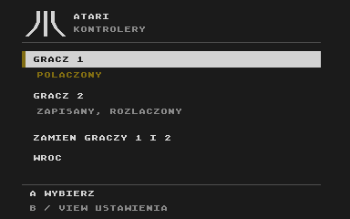

# Obsługa konsoli

[← Strona projektu](../README.md) · [Budowa krok po kroku](getting-started.md)

## Sterowanie

| Przycisk | Działanie |
| --- | --- |
| Krzyżak lub lewy drążek | Ruch w grze i wybór pozycji w menu |
| A lub RT | Główna akcja w grze; potwierdzenie wyboru w menu |
| View — dwa nachodzące kwadraty | Menu konsoli |
| RB | Atari OPTION |
| LB | Atari SELECT |
| LT | Atari START |
| X w bibliotece lub pauzie | Instrukcja wybranej gry |
| B w menu | Powrót do poprzedniego ekranu |

W bibliotece lewo i prawo zmieniają stronę listy. Instrukcja każdej gry ma dwie
strony: **Cel i zasady** oraz **Sterowanie**. Przełączasz je przyciskiem X albo
krzyżakiem w lewo lub w prawo. B lub View zamyka instrukcję.

Pozostałe funkcje ABXY zależą od gry i są opisane w jej instrukcji.
RB i LB nie otwierają menu emulatora.

## Język menu i instrukcji

W bibliotece **View** otwiera od razu Ustawienia. W grze lub BASIC-u naciśnij
View, a potem wybierz Ustawienia. Wskaż **JĘZYK: POLSKI** i naciśnij A, aby
włączyć angielski. Ta sama pozycja jako **LANGUAGE: ENGLISH** przełącza z powrotem
na polski. Wybór jest pamiętany po wyłączeniu zasilania. Nie tłumaczy oryginalnych
ekranów gier. [English DIY guide](getting-started.en.md)

## Gra w dwie osoby

Konsola pamięta przypisanie padów do graczy 1 i 2. Kolejność ich włączania
przy następnym uruchomieniu nie ma znaczenia.

Tryb jednoosobowy lub dwuosobowy, strony i poziom trudności wybierasz na
oryginalnych ekranach danej gry. Dotyczy to również Archona — konsola nie
zastępuje jego ekranu wyboru własnym menu.

## Zarządzanie padami



W bibliotece otwórz **View → Kontrolery**; w grze/BASIC-u:
**View → Ustawienia → Kontrolery**. Przy każdym graczu zobaczysz,
czy jego pad jest połączony, zapisany, ale rozłączony, czy jeszcze nieprzypisany.

- **Dodawanie:** wybierz wolnego gracza, a następnie **Dodaj pad**. Masz
  60 sekund na uruchomienie parowania przyciskiem obok USB pada. Po połączeniu
  naciśnij i puść A. B lub View anuluje dodawanie.
- **Zamiana:** wybierz **Zamień graczy 1 i 2**. Nowe przypisanie zostanie
  zapamiętane także po wyłączeniu konsoli. Puść przyciski, spusty i lewy drążek,
  aby wznowić sterowanie.
- **Usuwanie:** wybierz gracza, **Usuń przypisanie** i potwierdź. Pad zostanie
  rozłączony, a ustawienia drugiego pozostaną zapisane. Aby zastąpić pad innym,
  usuń jego przypisanie i dodaj nowy do zwolnionego miejsca.

Usuwanie dotyczy przypisania w konsoli. Nie kasuje wszystkich kluczy Bluetooth
przechowywanych przez bibliotekę. Usunięty pad może wrócić do sterowania dopiero
po ponownym dodaniu. Po usunięciu ostatniego przypisania konsola automatycznie
czeka na pad dla gracza 1, aby umożliwić ponowną obsługę menu.

Przy pierwszym uruchomieniu bez zapisanych padów dodawanie gracza 1 jest
aktywne automatycznie i bez limitu czasu. Kolejne pady dodajesz z menu.

## Biblioteka gier

Przy starcie konsola sprawdza, które znane pliki znajdują się na karcie.
Dopiero A na wybranym tytule rozpoczyna wczytywanie i sprawdzanie zawartości.
Podczas gry konsola korzysta z pamięci PSRAM, więc karta nie jest odczytywana.
Restart tego samego tytułu nie wymaga ponownego wczytywania pliku.

Przygaszona pozycja oznacza brak pliku, niewłaściwy rozmiar lub brak wymaganego
ROM-u systemowego. Samo skopiowanie dowolnej nowej gry na kartę nie dodaje jej
do menu — obecny katalog ma zdefiniowane nazwy, wersje i ustawienia.

### Tytuły w katalogu

Katalog zawiera **33 tytuły**. To metadane, nie pakiet plików gier.

| Gra | System Atari |
| --- | --- |
| Agent USA | AltirraOS |
| Alley Cat | Własny ROM XL rev. 2 |
| Archon | AltirraOS |
| Archon II: Adept | AltirraOS |
| Blue Max | AltirraOS |
| Boulder Dash | AltirraOS |
| Bruce Lee | AltirraOS |
| Dropzone | AltirraOS |
| Fred | AltirraOS |
| H.E.R.O. | AltirraOS |
| Hans Kloss | AltirraOS |
| International Karate | AltirraOS |
| Jungle Hunt | AltirraOS |
| Karateka | AltirraOS |
| Keystone Kapers | AltirraOS |
| Misja | Własny ROM XL rev. 2 |
| Montezuma's Revenge | AltirraOS |
| New York City - The Big Apple | Własny ROM XL rev. 2 |
| Ninja | AltirraOS |
| One-on-One | AltirraOS |
| Pac-Man | AltirraOS |
| Pole Position | AltirraOS |
| RealSports Tennis | AltirraOS |
| River Raid | AltirraOS |
| Road Race | Własny ROM XL rev. 2 |
| Robbo | AltirraOS |
| Seksmisja - A.D. 2044 | AltirraOS |
| Spy vs. Spy | Własny ROM XL rev. 2 |
| Spy vs. Spy II | Własny ROM XL rev. 2 |
| The Goonies | AltirraOS |
| The Last Starfighter | AltirraOS |
| Tron (Mirage) | AltirraOS |
| Zorro | AltirraOS |

Pliki dostarczasz samodzielnie. Przygotowanie karty opisuje
[etap 11 instrukcji budowy](getting-started.md#11-dodaj-własne-gry).

**Agent USA:** podróże wymagają wpisywania nazwy celu na klawiaturze Atari;
sam pad nie wystarcza. Obecny firmware nie obsługuje jeszcze klawiatury BT.
Katalog oznacza dostępne profile, nie potwierdzenie pełnej obsługi każdej gry
wyłącznie kontrolerem. Sprawdzaj jej instrukcję ekranową.

**Seksmisja** korzysta z dwóch stron dysku, wczytywanych razem. Gdy poprosi
o zmianę strony, otwórz View i wybierz **WŁÓŻ STRONĘ A/B**.

**Alley Cat, Misja, New York City - The Big Apple, Road Race i obie części
Spy vs. Spy** wymagają własnego ROM-u Atari XL
dołączonego do lokalnej kompilacji. Pozostałe profile korzystają z AltirraOS.

## BASIC bez karty

Jeśli karta nie odpowiada, po krótkim komunikacie pojawi się Altirra BASIC
z napisem `Ready`. View otwiera menu z powrotem do BASIC-a i ustawieniami.
Klawiatura Bluetooth oraz zapis własnych programów są planowane.

Jeśli karta jest włożona, a mimo to uruchamia się BASIC, sprawdź połączenia
i zasilanie czytnika. Moduł nie ma osobnego czujnika obecności karty, więc brak
odpowiedzi może też oznaczać problem z przewodami lub samą kartą.

Kartę zmieniaj przy wyłączonym zasilaniu. Aby wrócić do biblioteki, wyłącz
konsolę, włóż kartę i uruchom ją ponownie.

## Aktualizacja przez Wi-Fi

1. Na komputerze przygotuj nowy program poleceniem `tools/build.py`.
2. W bibliotece wybierz **View → Aktualizacja Wi-Fi → A**. W grze lub BASIC-u
   po View przejdź najpierw do Ustawień. Po angielsku: **SETTINGS / WI-FI UPDATE**.
3. Odczytaj z telewizora adres IP i uruchom na komputerze:

   ```powershell
   .\.venv\Scripts\python.exe tools/update.py --host ADRES_Z_EKRANU
   ```

4. Poczekaj na zakończenie i ponowne uruchomienie konsoli.

Komputer i konsola muszą być w tej samej sieci. Zachowaj plik
`local/config.json` z pierwotnym tokenem aktualizacji. Jeśli tryb aktualizacji
zdążył wygasnąć, włącz go ponownie z menu.

Przez pozostały czas Wi-Fi jest wyłączone. Konsola nie sprawdza jeszcze
samodzielnie dostępności nowych wydań w internecie.

`tools/update.py` aktualizuje aplikację konsoli, a nie osobny aktualizator.
Nowe uruchomienie `configure.py` nie zmienia tokenu ani sieci zapisanych już
w tym aktualizatorze. Zachowaj oryginalny `local/config.json` dla swojej konsoli.

## Obraz i dźwięk

W telewizorze wybierz tryb obrazu **Gra**. Sama nazwa wejścia „Komputer” może
nie wyłączać przetwarzania obrazu powodującego opóźnienie.

Konwerter AV → HDMI wymaga osobnego zasilania USB. Oba kanały audio otrzymują
ten sam sygnał mono. [Diagnostyka połączeń →](getting-started.md#14-gdy-coś-nie-działa)
